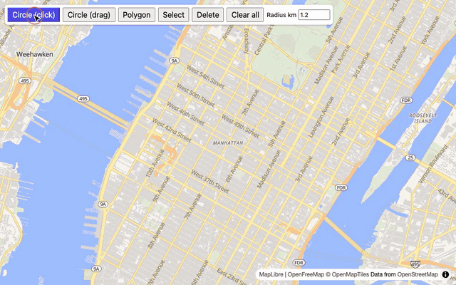
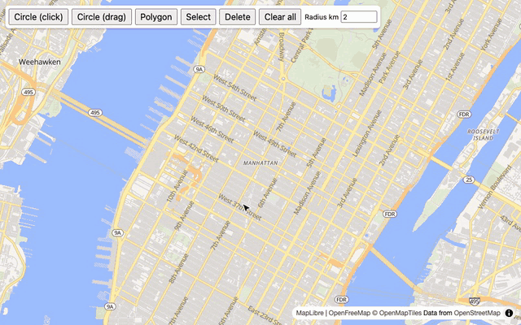

# mapbox-gl-draw-circle

Adds circle drawing and editing to [mapbox-gl-draw](https://github.com/mapbox/mapbox-gl-draw).

## Demo

##### Circle mode


##### Drag Circle mode


## Installation

```sh
npm install mapbox-gl-draw-circle @mapbox/mapbox-gl-draw mapbox-gl
```

- `@mapbox/mapbox-gl-draw` is a peer dependency, so install it yourself. Version **1.4.0 or newer** is required.
- The package is **ESM only**. It works with bundlers (Vite, webpack, Rollup, esbuild, Angular CLI, Next.js) and with Node `import`. `require()` also works on Node 20.19+ / 22.12+, which can load ES modules.

## Usage

```js
import mapboxgl from 'mapbox-gl';
import MapboxDraw from '@mapbox/mapbox-gl-draw';
import '@mapbox/mapbox-gl-draw/dist/mapbox-gl-draw.css';
import { CircleMode, DragCircleMode, DirectMode, SimpleSelectMode } from 'mapbox-gl-draw-circle';

const draw = new MapboxDraw({
  userProperties: true, // required: circles keep their center and radius in feature properties
  modes: {
    ...MapboxDraw.modes,
    draw_circle: CircleMode,
    drag_circle: DragCircleMode,
    direct_select: DirectMode,
    simple_select: SimpleSelectMode,
  },
});

map.addControl(draw); // add the control before calling draw.changeMode()

// Click once to draw a circle. The radius is in kilometers and defaults to 2.
draw.changeMode('draw_circle', { initialRadiusInKm: 0.5 });

// Or press, drag and release to draw a circle of any radius.
// A click without dragging draws nothing; Escape cancels the circle being drawn.
draw.changeMode('drag_circle');
```

- **`DirectMode` and `SimpleSelectMode`** replace the built-in `direct_select` and `simple_select` modes. They move a circle together with its center, and they resize it from any of its four handles. Ordinary features behave exactly as in the built-in modes.
- **Calling `draw.changeMode` too early** throws `Cannot read properties of undefined (reading 'changeMode')`. That happens if you call it before `map.addControl(draw)`; see [#56](https://github.com/iamanvesh/mapbox-gl-draw-circle/issues/56).

### Circle features

Circles fire the same [events](https://github.com/mapbox/mapbox-gl-draw/blob/main/docs/API.md#events) as other mapbox-gl-draw features (`draw.create`, `draw.update`, `draw.delete`, ...). A circle is a regular GeoJSON `Polygon` whose ring approximates the circle with 64 points. Its center and radius are in the properties:

```json
{
  "id": "e184898e58feaa5c2c56f20a178ffe2c",
  "type": "Feature",
  "properties": {
    "isCircle": true,
    "center": [-0.2472604947478203, 51.53200220026099],
    "radiusInKm": 2
  },
  "geometry": {
    "type": "Polygon",
    "coordinates": [[ /* 65 positions: 64 points plus the closing point */ ]]
  }
}
```

## TypeScript

The package ships its own types in `index.d.ts`. They build on the community types for mapbox-gl-draw:

```sh
npm install -D @types/mapbox__mapbox-gl-draw
```

```ts
import { CircleMode, type CircleModeOptions, type CircleProperties } from 'mapbox-gl-draw-circle';

const options: CircleModeOptions = { initialRadiusInKm: 0.5 };
// The community types only accept the built-in mode names, so custom modes need a cast.
draw.changeMode('draw_circle' as never, options as never);

map.on('draw.create', (e: { features: GeoJSON.Feature[] }) => {
  const { center, radiusInKm } = e.features[0].properties as CircleProperties;
});
```

## Frameworks

`fixtures/apps/` has working, CI-tested setups for React, Vue, Angular, Next.js and webpack.

- **React:** create the map in `useEffect` and return `() => map.remove()`. `StrictMode` mounts effects twice in development, and without the cleanup you get two maps. See [`fixtures/apps/react-vite`](fixtures/apps/react-vite/src/Map.jsx).
- **Vue:** create the map in `onMounted` and keep `map` and `draw` in plain variables, not `ref`/`reactive`. Vue's reactive proxies break mapbox-gl internals. See [`fixtures/apps/vue-vite`](fixtures/apps/vue-vite/src/App.vue).
- **Angular:** mapbox-gl and some of mapbox-gl-draw's dependencies are CommonJS. List them in `angular.json` to silence the build warnings:
  ```json
  "allowedCommonJsDependencies": ["mapbox-gl", "fast-deep-equal", "@mapbox/geojson-normalize", "@mapbox/geojson-area"]
  ```
  Creating the map inside `NgZone.runOutsideAngular` keeps map events out of change detection. See [`fixtures/apps/angular`](fixtures/apps/angular/src/app/app.component.ts).
- **Next.js:** top-level imports work in a `'use client'` component. Importing the package during server rendering does not touch `window`. See [`fixtures/apps/next`](fixtures/apps/next/app/Map.jsx).

## MapLibre (best effort)

mapbox-gl-draw doesn't officially support [MapLibre GL JS](https://maplibre.org/), so this plugin can't either. It does work in practice:
- Use `@mapbox/mapbox-gl-draw` 1.5.2 or newer, which improved style compatibility across both engines.
- Point draw's hard-coded `mapboxgl-*` CSS class names at MapLibre's before creating the control. Without this, keyboard shortcuts such as Delete and Escape stop working, and the control buttons lose their styling.

```js
import * as maplibregl from 'maplibre-gl';
import MapboxDraw from '@mapbox/mapbox-gl-draw';

Object.assign(MapboxDraw.constants.classes, {
  CANVAS: 'maplibregl-canvas',
  CONTROL_BASE: 'maplibregl-ctrl',
  CONTROL_PREFIX: 'maplibregl-ctrl-',
  CONTROL_GROUP: 'maplibregl-ctrl-group',
});

const draw = new MapboxDraw({ /* same options as above */ });
```

With Vite and maplibre-gl 6, the map may never load ("Worker failed to load"), because maplibre builds its worker URL at runtime. Bundle the worker yourself, as [`examples/demo/src/engine-maplibre.js`](examples/demo/src/engine-maplibre.js) does.

CI runs the browser tests on MapLibre as a non-blocking job.

## Migrating from 1.x

- **Install `@mapbox/mapbox-gl-draw` yourself.** It's now a peer dependency, version 1.4.0 or newer; 1.x bundled draw 1.1.1. Your app now uses a single copy of draw.
- **The package is ESM only.** See [Installation](#installation) for `require()` support.
- **Remove old workarounds.** Builds no longer need `legacy-peer-deps`, a `global` polyfill (`define: { global: 'globalThis' }`) or webpack `fs`/`path` fallbacks. Those were caused by draw 1.1.1's dependencies.
- **Import only from `mapbox-gl-draw-circle`.** Internal paths such as `mapbox-gl-draw-circle/lib/modes/CircleMode` are no longer importable.
- **`MapboxDraw.modes` is no longer changed.** Importing the plugin used to change `MapboxDraw.modes.simple_select` and `direct_select` for the whole page. Now circles get the circle behaviour only where you register `SimpleSelectMode` / `DirectMode`, as in the usage example.
- **Custom styles may need new layer ids.** mapbox-gl-draw 1.5 renamed its default style layers, for example `gl-draw-polygon-fill-inactive` became `gl-draw-polygon-fill`. This only matters if you pass custom `styles` or query draw's layers by id. See the [mapbox-gl-draw changelog](https://github.com/mapbox/mapbox-gl-draw/blob/main/CHANGELOG.md).

## Development

Run from the repository root:

```sh
npm ci && npm test                                       # unit tests (Jest)
(cd examples/demo && npm ci && npx playwright test)      # browser tests against the demo app
(cd fixtures && npm ci && node run.mjs)                  # build the packed package in consumer apps
```

The browser tests and fixtures need Chromium once: `npx playwright install chromium`.

`examples/demo` is also the interactive demo; see its [README](examples/demo/README.md) for setup and a manual test checklist. Run `npm run dev` there. Set `VITE_MAPBOX_TOKEN` for a real basemap, or `VITE_MAP_ENGINE=maplibre` to run it on MapLibre.

## License

MIT © Anvesh Arrabochu
